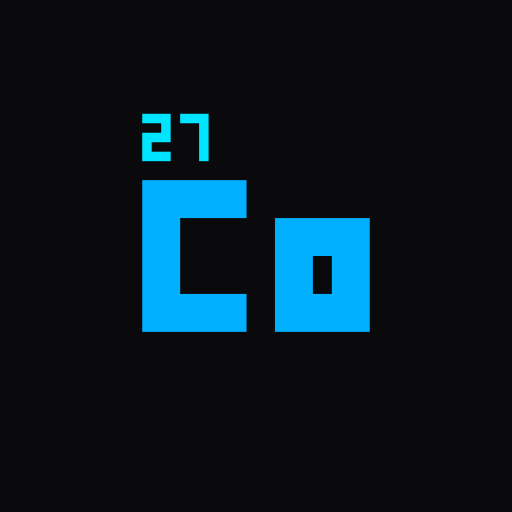
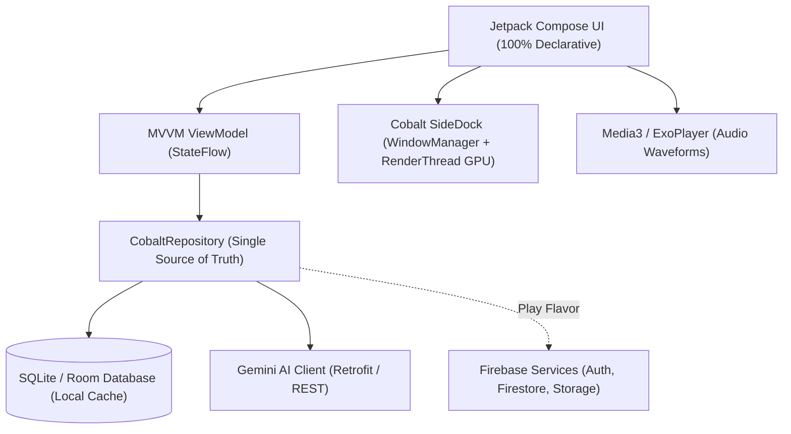

<div align="center">

  

  # Cobalt

  ### Universal Knowledge Archive & Instant Screen Capture for Android

  <p align="center">
    <a href="https://github.com/hanan-bhatti/cobalt/releases/latest">
      
    </a>
    <a href="https://f-droid.org/en/packages/com.hanan_bhatti.cobalt/">
      
    </a>
    <a href="LICENSE">
      
    </a>
    <a href="https://github.com/hanan-bhatti/cobalt/stargazers">
      
    </a>
  </p>

  <p align="center">
    
    &nbsp;
    
    &nbsp;
    
    &nbsp;
    
  </p>

  <p align="center">
    <b>A minimalist, offline-first personal knowledge base and universal capture suite for Android.</b><br/>
    Featuring the butter-smooth <b>Cobalt SideDock</b>, on-device Gemini AI OCR region marking, in-app Chrome Custom Tabs, and zero-telemetry local privacy.
  </p>

  <p align="center">
    <a href="https://f-droid.org/en/packages/com.hanan_bhatti.cobalt/">
      
    </a>
    &nbsp;&nbsp;&nbsp;&nbsp;
    <a href="https://github.com/hanan-bhatti/cobalt/releases/latest">
      
    </a>
  </p>

</div>

---

## 📖 Table of Contents

- [Overview](#-overview)
- [FOSS vs. Play Flavors](#-foss-vs-play-flavors)
- [Screenshots](#-screenshots)
- [Key Features](#-key-features)
  - [⚡ Cobalt SideDock](#-cobalt-sidedock-100-jetpack-compose)
  - [🔍 Gemini AI OCR & Region Marking](#-gemini-ai-ocr--region-marking)
  - [🌐 Chrome Custom Tabs](#-chrome-custom-tabs-integration)
  - [🎙️ AI Voice Memos](#️-ai-voice-memos--markdown-transcription)
  - [🌍 Multi-Language & RTL](#-automatic-rtl--multi-language-support)
  - [🎨 Material 3 Expressive UI](#-material-3-expressive-design)
- [Tech Stack](#-tech-stack)
- [Permissions](#-permissions)
- [Building from Source](#-building-from-source)
- [Star History](#-star-history)
- [License](#-license)

---

## 🌟 Overview

**Cobalt** (`com.hanan_bhatti.cobalt`) is designed to eliminate the friction of digital hoarding and information fragmentation. It acts as your single, centralized vault for ideas, articles, documents, audio clips, snapshots, and shared web content.

With Cobalt, you never need to leave your current task to save a thought or extract text. A gentle swipe from the screen edge summons the **Cobalt SideDock**, letting you snap notes, launch OCR bounding-box recognition over other apps, bookmark links, or search your library with zero frame drops.

---

## 📦 FOSS vs. Play Flavors

Cobalt is intentionally engineered into **two distinct distribution flavors** to give you total control over privacy, cloud connectivity, and Google dependencies:

<div align="center">

| Feature | 🌿 FOSS Edition (F-Droid) | ⚡ Play Edition (Google Play) |
|---|---|---|
| **Distribution** | [F-Droid Package](https://f-droid.org/en/packages/com.hanan_bhatti.cobalt/) & [GitHub Releases](https://github.com/hanan-bhatti/cobalt/releases/latest) | Google Play Store & [GitHub Releases](https://github.com/hanan-bhatti/cobalt/releases/latest) |
| **Google Dependencies** | **0% — Completely De-Googled** | Google Play Services enabled |
| **Telemetry & Trackers** | **Zero / None** (No analytics, pure privacy) | Firebase Analytics (Opt-in crash monitoring) |
| **Primary Database** | Encrypted Local SQLite (Room Database) | Encrypted Local SQLite (Room Database) |
| **Cloud Synchronization** | Offline-First (Manual JSON Backup & Restore) | Automated Cloud Firestore & Firebase Storage Sync |
| **Authentication** | None needed (Immediate local access) | Google Sign-In & Passwordless Email Link |
| **Gemini AI Engine** | Direct user Gemini API Key via Retrofit | Direct Gemini API Key & Firebase AI services |
| **Background Footprint** | Extremely low battery and memory usage | Cloud sync background services |
| **License** | 100% Free & Open Source (AGPL v3.0) | 100% Free & Open Source (AGPL v3.0) |

</div>

> [!NOTE]
> **Which flavor should I choose?**
> * **Choose FOSS** if you value strict privacy, use a de-Googled ROM (GrapheneOS, CalyxOS, LineageOS), or prefer installing updates through [F-Droid](https://f-droid.org/en/packages/com.hanan_bhatti.cobalt/).
> * **Choose Play** if you want seamless automatic cloud backups across multiple Android devices and convenient Google account synchronization.

---

## 📱 Screenshots

<p align="center">
  
  &nbsp;
  
  &nbsp;
  
</p>

<p align="center">
  
  &nbsp;
  
  &nbsp;
  
</p>

> [!TIP]
> For a full visual walkthrough of all 14 screens, theme variations, and workflows, check out the [Screenshots Directory Guide](assets/screenshots/README.md).

---

## 🚀 Key Features

### ⚡ Cobalt SideDock (100% Jetpack Compose)
* **Decoupled Two-Window System**: The idle handle lives at the screen edge occupying a razor-thin window (`thickness + 16dp`), consuming **0% CPU and zero rendering cycles** when resting.
* **Fluid 60fps / 90fps / 120fps Animations**: When triggered, the dock animates using GPU RenderThread transforms (`Modifier.graphicsLayer`). Zero window layout resizing Binder transactions occur during animation, eliminating all stutter and dropped frames even on budget chipsets.
* **Inline Quick Note Scratchpad**: Write down thoughts instantly without opening the app; notes are saved directly to Room with automatic home widget updates.
* **Live Recent Items & Tool Shortcuts**: One-tap access to your 4 latest items, OCR screen capture, link bookmarking, and instant media search.
* **Smart Gesture Controls**: Swipe inward to expand, swipe toward the edge to dismiss, or long-press and drag to reposition the handle vertically along the display.

### 🔍 Gemini AI OCR & Region Marking
* **MediaProjection Screen Snapping**: Transparent background snapshotting cleanly captures screen contents without capturing the capture UI.
* **Interactive Bounding Box**: Drag a marquee box over any region to send cropped visuals directly to the Gemini AI API for instantaneous text extraction.
* **Smart Link & Content Parsing**: Automatically parses URLs and code snippets within extracted screenshots, allowing 1-tap folder categorization.

### 🌐 Chrome Custom Tabs Integration
* **Seamless In-App Web Browsing**: Web links open directly inside high-performance, themed Chrome Custom Tabs, preserving your existing browser login sessions and cookies.
* **Bottom Action Bar**: Includes a 1-tap system share action and clipboard fallback without leaving the current reading view.

### 🎙️ AI Voice Memos & Markdown Transcription
* **Live Dynamic Waveform Visualizer**: Monitor vocal input with real-time audio amplitudes and local cache buffering.
* **Gemini Audio Transcription**: High-accuracy speech-to-text powered by Gemini AI models.
* **Automatic Markdown Polishing**: Automatically structures raw audio notes with contextual titles, bullet lists, and summary paragraphs.

### 🌍 Automatic RTL & Multi-Language Support
* **Native Bidirectional Layouts**: Intelligently detects Right-to-Left (RTL) scripts (Urdu, Arabic, Hebrew) and dynamically flips reading direction, margins, and typography in Markdown renders and edit fields.

### 🎨 Material 3 Expressive Design
* **Glassmorphic Haze Effects**: Subtle background blurs and frosted glass backdrops using modern hardware-accelerated Haze shaders.
* **Dynamic Material You Accents**: Automatically harmonizes with your system wallpaper palette on Android 12+.
* **Sticker-Themed Folders & Drag-to-Reorder**: Reorder memory cards and organize categories with custom curated color pills.

---

## 🛠️ Tech Stack

Cobalt is built with modern, battle-tested Android architecture:



* **UI Framework**: [Jetpack Compose](https://developer.android.com/jetpack/compose) with Material Design 3 Expressive
* **Language & Coroutines**: [Kotlin 2.1](https://kotlinlang.org/) + Coroutines & StateFlow
* **Database Engine**: [Android Room (SQLite)](https://developer.android.com/training/data-storage/room)
* **Glassmorphism / Blur**: [Haze 1.7.2](https://github.com/chrisbanes/haze)
* **Audio & Playback**: [AndroidX Media3 (ExoPlayer)](https://developer.android.com/media/media3)
* **Web Integration**: [AndroidX Browser (Chrome Custom Tabs)](https://developer.android.com/jetpack/androidx/releases/browser)
* **Widgets**: [Jetpack Glance](https://developer.android.com/jetpack/compose/glance)
* **Network & Serializer**: Retrofit 2 + Moshi Kotlin + OkHttp 4
* **Cloud Services (Play Edition)**: Firebase Firestore, Firebase Storage, Firebase Auth, Google Credential Manager

---

## 🔒 Permissions

Cobalt uses only the permissions required to deliver its capture and background features:

| Permission | Type | Reason |
|---|---|---|
| `SYSTEM_ALERT_WINDOW` | Special | Renders the featherweight **Cobalt SideDock** handle over other applications. |
| `FOREGROUND_SERVICE` | Normal | Maintains active OCR region capture and audio transcription services. |
| `FOREGROUND_SERVICE_MEDIA_PROJECTION` | Foreground | Enables screen projection for region-based OCR screenshot selection. |
| `FOREGROUND_SERVICE_SPECIAL_USE` | Foreground | Keeps the Cobalt SideDock handle service responsive in background memory. |
| `RECORD_AUDIO` | Runtime | Captures voice memos for speech-to-text transcription. |
| `INTERNET` | Normal | Communicates with the Gemini API and fetches link preview metadata. |
| `ACCESS_NETWORK_STATE` | Normal | Checks network connectivity to optimize API requests and conserve battery. |
| `POST_NOTIFICATIONS` | Runtime | Displays ongoing status notifications for active screen capture or sync jobs. |
| `RECEIVE_BOOT_COMPLETED` | Normal | Restores the SideDock handle and glance widget updates upon device reboot. |

---

## 🔨 Building from Source

### Prerequisites
* **Java Development Kit (JDK)**: Version 21
* **Android SDK**: Compile SDK `35` / Target SDK `35` (Supports Android 7.0+ API 24)

### 1. Clone Repository
```bash
git clone https://github.com/hanan-bhatti/cobalt.git
cd cobalt
```

### 2. Build Your Desired Flavor

* **To build the FOSS release APK (De-Googled, F-Droid flavor)**:
  ```bash
  ./gradlew assembleFossRelease
  ```
  *Output: `app/build/outputs/apk/foss/release/app-foss-release.apk`*

* **To build the Play release APK (Firebase cloud sync flavor)**:
  ```bash
  ./gradlew assemblePlayRelease
  ```
  *(Requires `app/src/play/google-services.json`)*

* **To build debug APK for rapid development**:
  ```bash
  ./gradlew assembleFossDebug
  ```

---

## 📈 Star History

<div align="center">

<a href="https://www.star-history.com/?repos=hanan-bhatti%2Fcobalt&type=date&legend=top-left">
 <picture>
   <source media="(prefers-color-scheme: dark)" srcset="https://api.star-history.com/chart?repos=hanan-bhatti/cobalt&type=date&theme=dark&legend=top-left" />
   <source media="(prefers-color-scheme: light)" srcset="https://api.star-history.com/chart?repos=hanan-bhatti/cobalt&type=date&legend=top-left" />
   
 </picture>
</a>

</div>

---

## 📄 License

Cobalt is free and open-source software released under the terms of the **[GNU Affero General Public License v3.0 (AGPL-3.0)](LICENSE)**.

```
Cobalt - A universal capture and personal knowledge archive
Copyright (C) 2026 Hanan Bhatti
```
