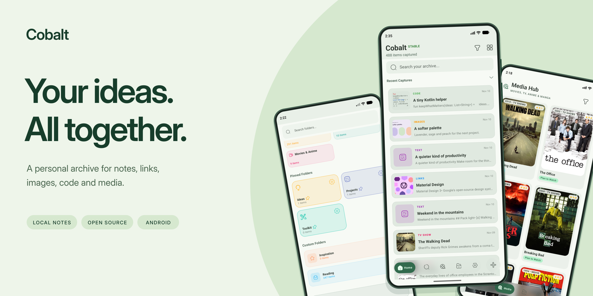
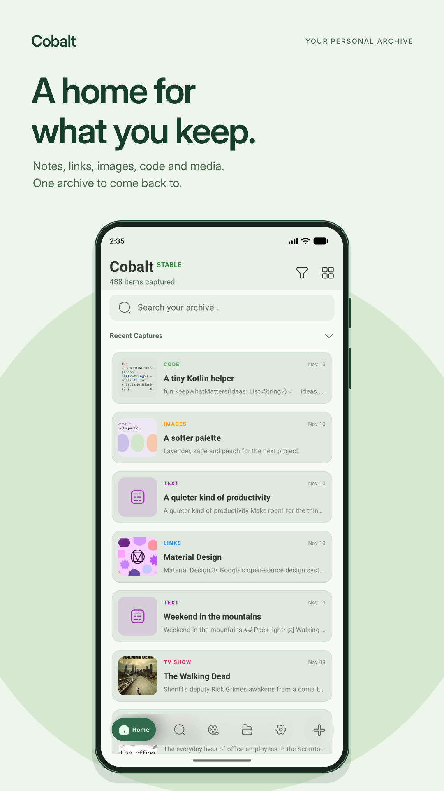
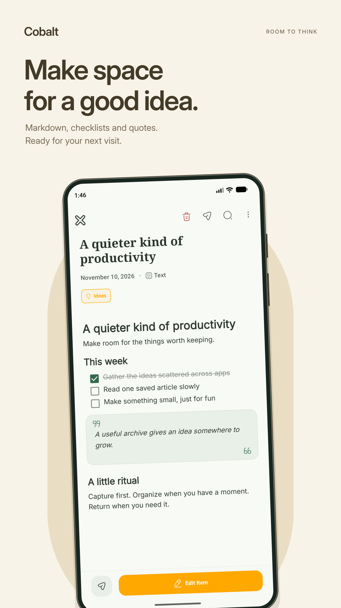
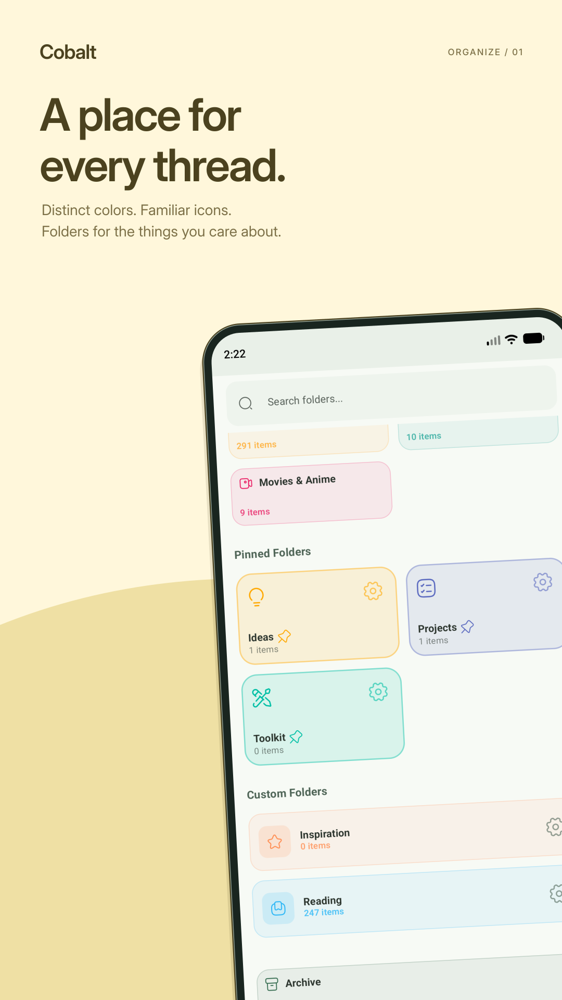
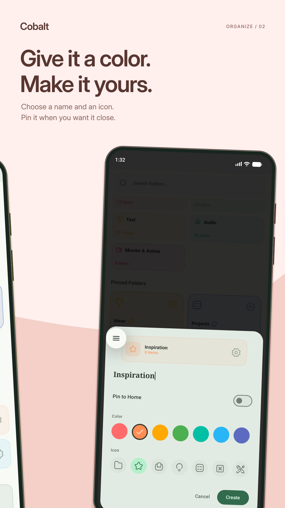
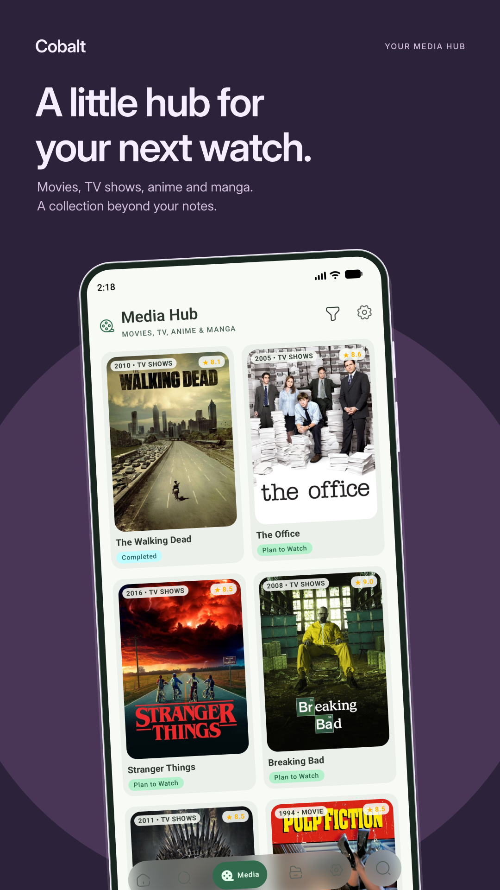
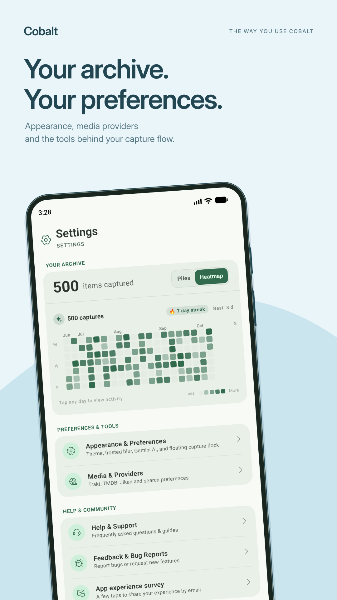
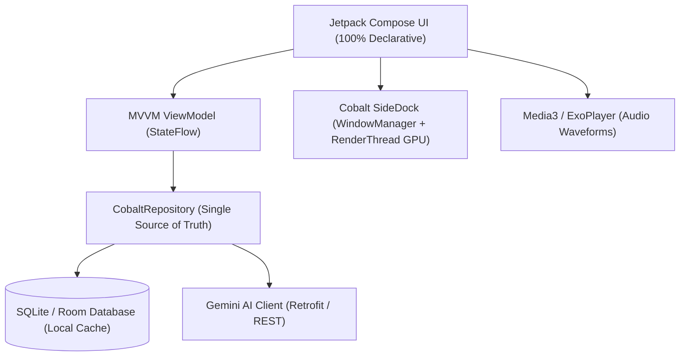

<div align="center">

  

  <br/><br/>

  <p align="center">
    <a href="https://github.com/hanan-bhatti/cobalt/releases/latest"></a>
    <a href="https://f-droid.org/en/packages/com.hanan_bhatti.cobalt/"></a>
    <a href="https://github.com/hanan-bhatti/cobalt"></a>
    <a href="https://github.com/hanan-bhatti/cobalt"></a>
    <a href="https://github.com/hanan-bhatti/cobalt"></a>
    <a href="https://github.com/hanan-bhatti/cobalt"></a>
    <a href="LICENSE"></a>
    <a href="https://github.com/hanan-bhatti/cobalt/stargazers"></a>
  </p>

  <p align="center">
    <b>A minimalist, offline-first personal knowledge base and universal capture suite for Android.</b><br/>
    Featuring the 60/120fps <b>Cobalt SideDock</b>, Gemini AI Vision OCR region marking, in-app Chrome Custom Tabs, and zero-telemetry local privacy.
  </p>

  <p align="center">
    <a href="https://f-droid.org/en/packages/com.hanan_bhatti.cobalt/"></a>&nbsp;&nbsp;&nbsp;&nbsp;<a href="https://github.com/hanan-bhatti/cobalt/releases/latest"></a>
  </p>

</div>

---

## 📖 Table of Contents

- [Overview](#-overview)
- [Cobalt distribution](#-cobalt-distribution)
- [Screenshots](#-screenshots)
- [Key Features](#-key-features)
  - [⚡ Cobalt SideDock](#-cobalt-sidedock-100-jetpack-compose)
  - [🔍 Gemini AI OCR & Region Marking](#-gemini-ai-ocr--region-marking)
  - [🌐 Chrome Custom Tabs](#-chrome-custom-tabs-integration)
  - [🎙️ AI Voice Memos](#️-ai-voice-memos--markdown-transcription)
  - [🌍 Multi-Language & RTL](#-automatic-rtl--multi-language-support)
  - [🎨 Material 3 Expressive UI](#-material-3-expressive-design)
- [Tech Stack](#-tech-stack)
- [Permissions](#-permissions)
- [Building from Source](#-building-from-source)
- [Star History](#-star-history)
- [License](#-license)

---

## 🌟 Overview

**Cobalt** (`com.hanan_bhatti.cobalt`) is designed to eliminate the friction of digital hoarding and information fragmentation. It acts as your single, centralized vault for ideas, articles, documents, audio clips, snapshots, and shared web content.

With Cobalt, you never need to leave your current task to save a thought or extract text. A gentle swipe from the screen edge summons the **Cobalt SideDock**, letting you snap notes, launch OCR bounding-box recognition over other apps, bookmark links, or search your library with zero frame drops.

---

## 📦 Cobalt distribution

Cobalt has one Android application, distributed through GitHub and F-Droid.
Notes are local. Optional integrations use your own credentials; see [NETWORK.md](NETWORK.md).

Use **Add → Import text** for Markdown, MDX, TXT and other supported text documents.
You can also send files to Cobalt through Android Share or Open with. MDX is stored
as inert text; it does not execute JavaScript. Large notes use the original detail
screen and a frameless scrolling capture body; native selection currently stays
within the focused text range.
Crash reports are saved locally and shared through an email chooser only on request.


## 📱 Screenshots

<p align="center">
  
  
  
</p>

<p align="center">
  
  
  
</p>

[Explore all 15 screenshots and the connected folder panorama](assets/screenshots/README.md).

---

## 🚀 Key Features

### ⚡ Cobalt SideDock (100% Jetpack Compose)
* **Decoupled Two-Window System**: The idle handle lives at the screen edge occupying a razor-thin window (`thickness + 16dp`), consuming **0% CPU and zero rendering cycles** when resting.
* **Fluid 60fps / 90fps / 120fps Animations**: When triggered, the dock animates using GPU RenderThread transforms (`Modifier.graphicsLayer`). Zero window layout resizing Binder transactions occur during animation, eliminating all stutter and dropped frames even on budget chipsets.
* **Inline Quick Note Scratchpad**: Write down thoughts instantly without opening the app; note bodies are saved as private Markdown files, with Room metadata and automatic home widget updates.
* **Live Recent Items & Tool Shortcuts**: A bounded list of up to 15 recent items with two-line previews, OCR screen capture, link bookmarking, and instant media search.
* **Smart Gesture Controls**: Swipe inward to expand, swipe toward the edge to dismiss, or long-press and drag to reposition the handle vertically along the display.

### 🔍 Gemini AI OCR & Region Marking
* **MediaProjection Screen Snapping**: Transparent background snapshotting cleanly captures screen contents without capturing the capture UI.
* **Interactive Bounding Box**: Drag a marquee box over any region to send cropped visuals directly to the Gemini AI API for instantaneous text extraction.
* **Smart Link & Content Parsing**: Automatically parses URLs and code snippets within extracted screenshots, allowing 1-tap folder categorization.

### 🌐 Chrome Custom Tabs Integration
* **Seamless In-App Web Browsing**: Web links open directly inside high-performance, themed Chrome Custom Tabs, preserving your existing browser login sessions and cookies.
* **Bottom Action Bar**: Includes a 1-tap system share action and clipboard fallback without leaving the current reading view.

### 🎙️ AI Voice Memos & Markdown Transcription
* **Live Dynamic Waveform Visualizer**: Monitor vocal input with real-time audio amplitudes and local cache buffering.
* **Gemini Audio Transcription**: High-accuracy speech-to-text powered by Gemini AI models.
* **Automatic Markdown Polishing**: Automatically structures raw audio notes with contextual titles, bullet lists, and summary paragraphs.

### 🌍 Automatic RTL & Multi-Language Support
* **Native Bidirectional Layouts**: Intelligently detects Right-to-Left (RTL) scripts (Urdu, Arabic, Hebrew) and dynamically flips reading direction, margins, and typography in Markdown renders and edit fields.

### 🎨 Material 3 Expressive Design
* **Glassmorphic Haze Effects**: Subtle background blurs and frosted glass backdrops using modern hardware-accelerated Haze shaders.
* **Dynamic Material You Accents**: Automatically harmonizes with your system wallpaper palette on Android 12+.
* **Custom Themed Folders**: Organize and pin custom color-coded categories with curated icons and multi-folder tagging.

---

## 🛠️ Tech Stack

Cobalt is built with modern, battle-tested Android architecture:



* **UI Framework**: [Jetpack Compose](https://developer.android.com/jetpack/compose) with Material Design 3 Expressive
* **Language & Coroutines**: [Kotlin 2.1](https://kotlinlang.org/) + Coroutines & StateFlow
* **Database Engine**: [Android Room (SQLite)](https://developer.android.com/training/data-storage/room)
* **Glassmorphism / Blur**: [Haze 1.7.2](https://github.com/chrisbanes/haze)
* **Audio & Playback**: [AndroidX Media3 (ExoPlayer)](https://developer.android.com/media/media3)
* **Web Integration**: [AndroidX Browser (Chrome Custom Tabs)](https://developer.android.com/jetpack/androidx/releases/browser)
* **Widgets**: [Jetpack Glance](https://developer.android.com/jetpack/compose/glance)
* **Network & Serializer**: Retrofit 2 + Moshi Kotlin + OkHttp 4

---

## 🔒 Permissions

Cobalt uses only the permissions required to deliver its capture and background features:

| Permission | Type | Reason |
|---|---|---|
| `SYSTEM_ALERT_WINDOW` | Special | Renders the featherweight **Cobalt SideDock** handle over other applications. |
| `FOREGROUND_SERVICE` | Normal | Maintains active OCR region capture and audio transcription services. |
| `FOREGROUND_SERVICE_MEDIA_PROJECTION` | Foreground | Enables screen projection for region-based OCR screenshot selection. |
| `FOREGROUND_SERVICE_SPECIAL_USE` | Foreground | Keeps the Cobalt SideDock handle service responsive in background memory. |
| `RECORD_AUDIO` | Runtime | Captures voice memos for speech-to-text transcription. |
| `INTERNET` | Normal | Communicates with the Gemini API and fetches link preview metadata. |
| `ACCESS_NETWORK_STATE` | Normal | Checks network connectivity to optimize API requests and conserve battery. |
| `POST_NOTIFICATIONS` | Runtime | Displays ongoing status notifications for active screen capture and user-enabled reminders. |
| `RECEIVE_BOOT_COMPLETED` | Normal | Restores the SideDock handle and glance widget updates upon device reboot. |

---

## 🔨 Building from Source

### Prerequisites
* **Java Development Kit (JDK)**: Version 21
* **Android SDK**: Compile SDK `35` / Target SDK `35` (Supports Android 7.0+ API 24)

### 1. Clone Repository
```bash
git clone https://github.com/hanan-bhatti/cobalt.git
cd cobalt
```

### 2. Build Your Desired Flavor

Build the single application with `./gradlew assembleRelease`.
The APK is written to `app/build/outputs/apk/release/`.
Release signing remains configured by the existing environment variables.


## 📈 Star History

<div align="center">

<a href="https://www.star-history.com/?repos=hanan-bhatti%2Fcobalt&type=date&legend=top-left">
 <picture>
   <source media="(prefers-color-scheme: dark)" srcset="https://api.star-history.com/chart?repos=hanan-bhatti/cobalt&type=date&theme=dark&legend=top-left" />
   <source media="(prefers-color-scheme: light)" srcset="https://api.star-history.com/chart?repos=hanan-bhatti/cobalt&type=date&legend=top-left" />
   
 </picture>
</a>

</div>

---

## 📄 License

Cobalt is free and open-source software released under the terms of the **[GNU Affero General Public License v3.0 (AGPL-3.0)](LICENSE)**.

```
Cobalt - A universal capture and personal knowledge archive
Copyright (C) 2026 Hanan Bhatti
```
