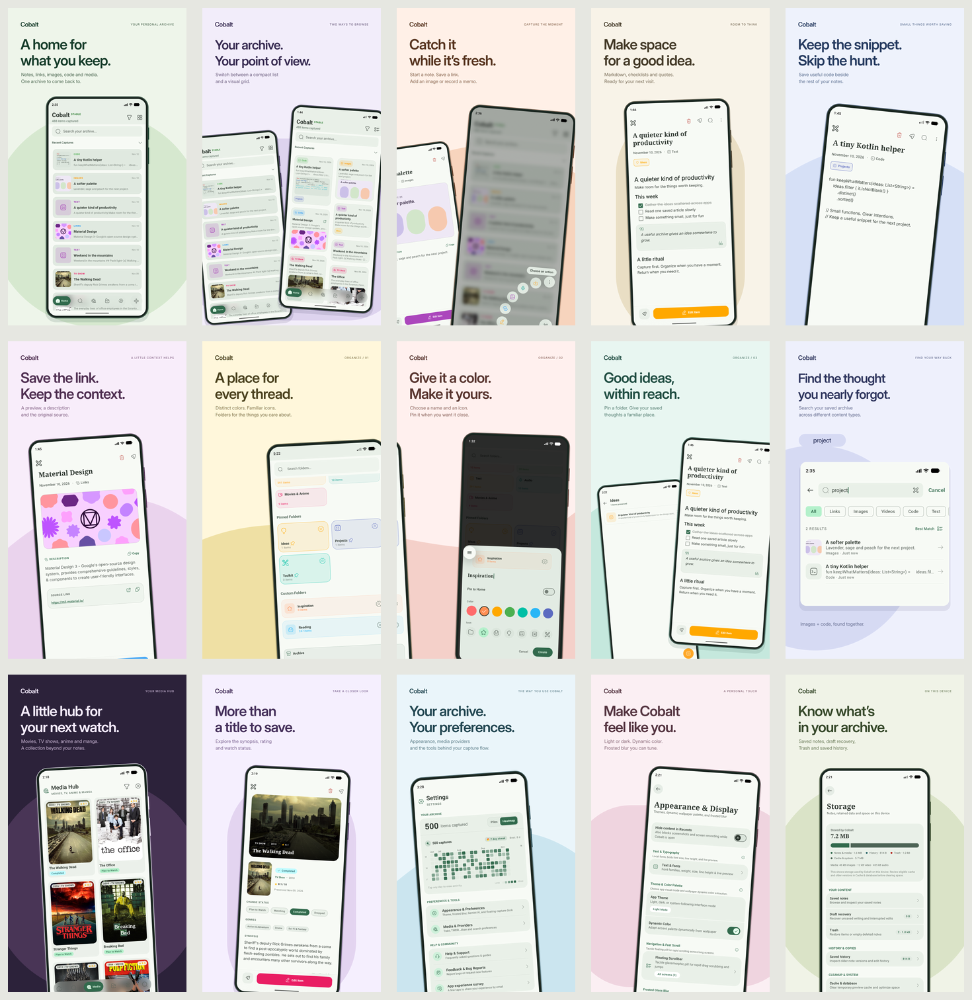

# Cobalt screenshot campaign

Fifteen 1080 × 1920 panels, each with a distinct Material 3 inspired tonal palette. The app UI comes from genuine emulator captures. Headlines, backgrounds, device frames and typography are separate editable design elements.



| Panel | Image | Focus |
| --- | --- | --- |
| 01 | [A home for what you keep.](01-home.png) | Your Personal Archive |
| 02 | [Your archive. Your point of view.](02-grid-and-list.png) | Two Ways To Browse |
| 03 | [Catch it while it’s fresh.](03-quick-capture.png) | Capture The Moment |
| 04 | [Make space for a good idea.](04-notes.png) | Room To Think |
| 05 | [Keep the snippet. Skip the hunt.](05-code.png) | Small Things Worth Saving |
| 06 | [Save the link. Keep the context.](06-links.png) | A Little Context Helps |
| 07 | [A place for every thread.](07-folders.png) | Organize / 01 |
| 08 | [Give it a color. Make it yours.](08-create-folder.png) | Organize / 02 |
| 09 | [Good ideas, within reach.](09-pinned-folder.png) | Organize / 03 |
| 10 | [Find the thought you nearly forgot.](10-search.png) | Find Your Way Back |
| 11 | [A little hub for your next watch.](11-media-hub.png) | Your Media Hub |
| 12 | [More than a title to save.](12-media-detail.png) | Take A Closer Look |
| 13 | [Your archive. Your preferences.](13-settings.png) | The Way You Use Cobalt |
| 14 | [Make Cobalt feel like you.](14-appearance.png) | A Personal Touch |
| 15 | [Know what’s in your archive.](15-storage.png) | On This Device |

Panels 07–09 form a connected composition. [View the full panorama](07-09-organize-panorama.png). The wide [README banner](../banner.png) is 2560 × 1280.

The heatmap uses a separate debug build matching the current product code with 500 disposable demo captures distributed across 85 days. Other screens use the installed production app. No app UI was generated or repainted. Search is presented as an enlarged crop of the genuine results screen.

[Editable Figma file](https://www.figma.com/design/Im9uv0k2UCK8B4VJ4irKnv/) · [Vector sources and build script](../../design/showcase/)

## Updating the gallery

The source campaign lives in `design/showcase/`. To copy its approved exports everywhere:

```text
python3 design/showcase/build_assets.py --publish-only
python3 design/showcase/build_assets.py --check
```

Running the same script without flags rebuilds the vector layouts with ImageMagick and publishes the results. Both commands synchronize the README gallery, F-Droid phone screenshots, website screenshots and banners.
