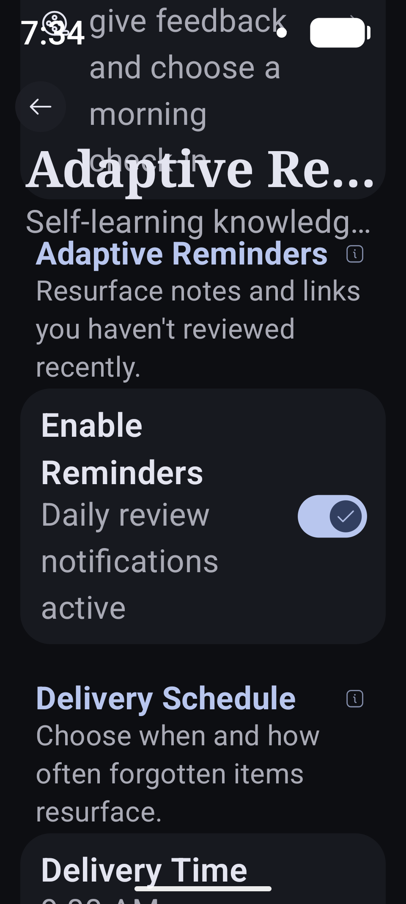
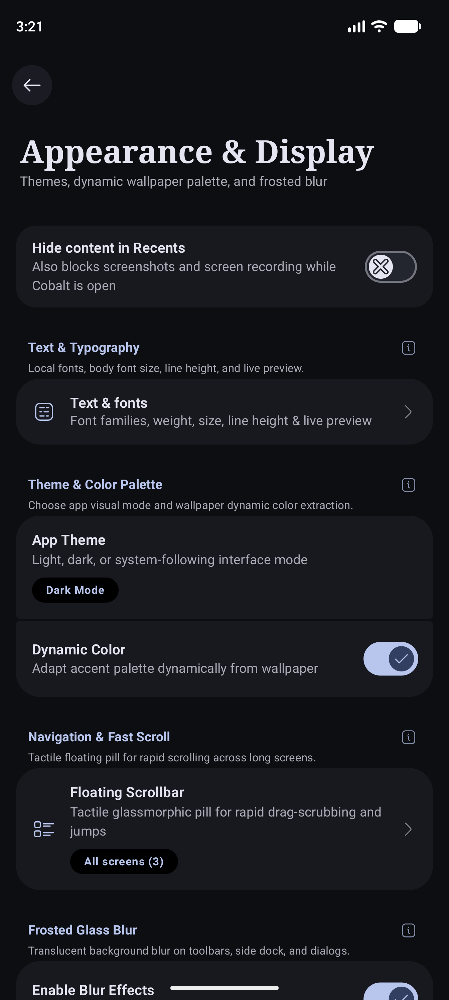

# Cobalt layout and interface writing audit

Completed 16 November 2026. Live evidence was captured on 15 November in the supplied session; the report was finished after recovering that evidence and checking the principal findings against the current source.

## Result

Settings makes ordinary choices harder to scan by repeating a section heading, explanation, info dialog, control label and another explanation. The problem appears across Appearance, Fonts, Folders, Reminders, Gemini and Dock. The redesign should give each choice one clear label, group related controls, and show detailed explanations when they help someone make a decision.

Correctness comes first: large text causes a real header overlap; Gemini processing is described as on-device; feedback claims delivery before a message is sent; and a folder search with no matches claims no folders exist. These need correction before visual polish.

This is an audit and a proposed redesign direction. Application code and settings were not changed during this continuation. Only reports and copies of existing screenshots were added. The earlier session temporarily previewed reminder and Dock settings and recorded restoring them; screen size and font scale are currently back to their original values.

The [complete source writing audit](cobalt-ui-writing-source-2026-11-15.md) contains 38 grouped findings: 16 HIGH, 19 MEDIUM and 3 LOW. The tables below add the live layout findings and highlight the most consequential writing findings. Counts describe root causes, not distinct screens.

## Evidence and coverage

| Check | Evidence and limit |
| --- | --- |
| Installed build | Cobalt debug, package com.hanan_bhatti.cobalt.debug, version 2.3.0 (20), on emulator-5554. Its last update is still 14 November 2026 at 18:07:23, matching the prior session. The separately installed release build was not the live audit target. |
| Normal phone layout | 1344 × 2992 physical pixels at 480 dpi, approximately 448 dp wide, dark appearance and font scale 1.0. Live navigation included Settings, its available subpages, pickers, expanded controls and main screens. |
| Narrow and large text | Reminders was examined at 320 dp with font scales 1.0 and 2.0, and at 448 dp with font scale 2.0, including scrolled controls. Android font scale 2.0 is the native large-text test; it is not browser zoom. |
| Recovered evidence | 117 screenshot and UI hierarchy pairs, including repeated states and five size/text stress captures. 29 representative screenshots are preserved beside this report. [Evidence index](cobalt-ui-layout-writing-2026-11-16/evidence-index.md). |
| Current source | Branch main with existing uncommitted feature work. Principal capability, state, layout and action findings were checked against their owning source. The installed APK and current worktree must be treated separately. |
| Source-only coverage | Web Companion and both browser clients, OCR and recording copy, failure/recovery branches, alternate render paths and some newer Screening details. Web Companion was absent from the installed preference index. Their current live rendering is Not verified. |

Live settings coverage included Appearance and blur, scrolling controls, font families and metrics, folder ranking and activity style, Reminders, Gemini models/prompt/sensitivity/usage, Dock permissions/position/animation, widget gallery/Pocket Folio/Screening Card, Screening picks/taste/morning questions, Storage/saved notes/drafts/Trash/history/cache/versions/unlinked files, migration status, background activity, Media providers/TMDB/Trakt/pending changes, Help, feedback, survey, updates, About and legal pages. Home, Search, Folders, note reading/actions, Media/details/filter/search and quick-note capture were also visited.

Not verified: full RTL mirroring, pseudo-localization or long translations, light appearance, landscape/tablet layouts, every page at large text, browser 320 px/200% zoom, TalkBack or keyboard focus, all keyboard/save combinations, actual provider failures and generated content, connected Trakt account states, completed feedback delivery, and destructive recovery/cleanup outcomes. The Urdu text sample in Fonts is not a full RTL layout test. No app rebuild or installation was used to turn source-only findings into live claims.

## Layout findings

### Plan for growth and clipping

| Severity | Location | Before | After | Why |
| --- | --- | --- | --- | --- |
| HIGH L1 | [ui/components/CollapsibleCommonTopBar.kt:162](/home/hanan-bhatti/StudioProjects/second-brain/app/src/main/kotlin/com/example/ui/components/CollapsibleCommonTopBar.kt:162); [ui/screens/AdaptiveRemindersSettingsScreen.kt:166](/home/hanan-bhatti/StudioProjects/second-brain/app/src/main/kotlin/com/example/ui/screens/AdaptiveRemindersSettingsScreen.kt:166); [320 dp, large text evidence](cobalt-ui-layout-writing-2026-11-16/test-reminders-320dp-font2.png) | At 320 dp and font scale 2.0, the Reminders title and subtitle overlap the first settings card. The page title is also cut to “Adaptive Re…”. | Use an app bar that reserves measured space for its text and navigation, plus content padding based on that measured height. Let necessary text wrap or provide its complete value. Recheck the expanded and collapsed states. | The header has a bounded height and one-line text while the first card grows. Live overlap obscures content. The shared component creates a risk on other pages, but those pages have not all been tested at this size. Shortening the title alone does not fix the structure. |

### Order by importance

| Severity | Location | Before | After | Why |
| --- | --- | --- | --- | --- |
| MEDIUM L2 | [ui/screens/ProfileMainContent.kt:161](/home/hanan-bhatti/StudioProjects/second-brain/app/src/main/kotlin/com/example/ui/screens/ProfileMainContent.kt:161); [ui/screens/ProfileMainContent.kt:301](/home/hanan-bhatti/StudioProjects/second-brain/app/src/main/kotlin/com/example/ui/screens/ProfileMainContent.kt:301); [ui/screens/ProfileSettings.kt:301](/home/hanan-bhatti/StudioProjects/second-brain/app/src/main/kotlin/com/example/ui/screens/ProfileSettings.kt:301); [Settings entry](cobalt-ui-layout-writing-2026-11-16/03-settings-root.png) | A large activity dashboard sits before preferences. “Appearance & Preferences” then opens another screen titled “Settings”, containing unrelated settings such as Storage and background activity. | Put settings destinations first and link directly to their pages. Move activity to a separate activity view. Use short group headings for related destinations. | Someone opening Settings must pass content unrelated to changing a preference, then interpret a second index. Storage and capture settings are harder to find beneath an Appearance label. |
| MEDIUM L3 | [ui/screens/ProfileSettings.kt:969](/home/hanan-bhatti/StudioProjects/second-brain/app/src/main/kotlin/com/example/ui/screens/ProfileSettings.kt:969); [ui/screens/EdgePanelAnimationSettingsScreen.kt:260](/home/hanan-bhatti/StudioProjects/second-brain/app/src/main/kotlin/com/example/ui/screens/EdgePanelAnimationSettingsScreen.kt:260); [Gemini prompt](cobalt-ui-layout-writing-2026-11-16/27-gemini-models.png); [Dock tuning](cobalt-ui-layout-writing-2026-11-16/39-dock-motion.png) | Gemini shows the full extraction prompt by default, above audio settings. Dock animation presents technical descriptions and tension/damping values for each choice. | Keep model selection and ordinary animation choices in the main flow. Put custom prompts and numerical tuning behind an explicit Advanced or Edit control. Keep a preview and selected value visible. | Advanced material dominates the pages before common choices. This is a layout and writing change; detailed controls should remain discoverable and usable. |
| MEDIUM L4 | [ui/screens/TextAndFontsSettingsScreen.kt:604](/home/hanan-bhatti/StudioProjects/second-brain/app/src/main/kotlin/com/example/ui/screens/TextAndFontsSettingsScreen.kt:604); [ui/screens/WidgetSettingsScreen.kt:270](/home/hanan-bhatti/StudioProjects/second-brain/app/src/main/kotlin/com/example/ui/screens/WidgetSettingsScreen.kt:270); [ui/screens/ScreeningWidgetSettingsScreen.kt:121](/home/hanan-bhatti/StudioProjects/second-brain/app/src/main/kotlin/com/example/ui/screens/ScreeningWidgetSettingsScreen.kt:121); [Fonts](cobalt-ui-layout-writing-2026-11-16/07-text-fonts-top.png); [Folio](cobalt-ui-layout-writing-2026-11-16/46-pocket-folio-top.png); [Screening Card](cobalt-ui-layout-writing-2026-11-16/51-screening-widget-top.png) | Large previews appear before settings. Fonts includes a full paragraph, checklist, quote, code and Urdu sample before reaching ordinary choices. Widget artwork occupies much of the first view. | Show a compact preview beside or immediately after the first meaningful choice. Offer Expand preview for the full example. Bring font/preset, widget folder/source and placement action into the initial reading order. | A useful preview should support a choice. Its present size delays reaching the controls. Preserve a full preview for checking formatting and different scripts. |
| MEDIUM L5 | [ui/screens/WidgetSettingsScreen.kt:54](/home/hanan-bhatti/StudioProjects/second-brain/app/src/main/kotlin/com/example/ui/screens/WidgetSettingsScreen.kt:54); [Widget gallery](cobalt-ui-layout-writing-2026-11-16/45-widgets-index.png) | An unavailable Capture Ticket is the first widget, and other future widgets are interleaved with usable ones. | List Pocket Folio and Screening Card first. Move unavailable designs to an optional Coming later section. | The first selectable destination should help someone add a widget now. Unavailable rows weaken the page’s primary task. |

### Group with space and remove repeated hierarchy

| Severity | Location | Before | After | Why |
| --- | --- | --- | --- | --- |
| MEDIUM L6 | [ui/components/ExpressiveSettingsComponents.kt:87](/home/hanan-bhatti/StudioProjects/second-brain/app/src/main/kotlin/com/example/ui/components/ExpressiveSettingsComponents.kt:87); [ui/screens/ProfileSettings.kt:544](/home/hanan-bhatti/StudioProjects/second-brain/app/src/main/kotlin/com/example/ui/screens/ProfileSettings.kt:544); [ui/screens/TextAndFontsSettingsScreen.kt:323](/home/hanan-bhatti/StudioProjects/second-brain/app/src/main/kotlin/com/example/ui/screens/TextAndFontsSettingsScreen.kt:323); [ui/screens/ArchiveOrganizationSettingsScreen.kt:86](/home/hanan-bhatti/StudioProjects/second-brain/app/src/main/kotlin/com/example/ui/screens/ArchiveOrganizationSettingsScreen.kt:86); [ui/screens/AdaptiveRemindersSettingsScreen.kt:198](/home/hanan-bhatti/StudioProjects/second-brain/app/src/main/kotlin/com/example/ui/screens/AdaptiveRemindersSettingsScreen.kt:198); [Appearance](cobalt-ui-layout-writing-2026-11-16/05-appearance-top.png); [Folder settings](cobalt-ui-layout-writing-2026-11-16/15-organization-top.png); [Reminders](cobalt-ui-layout-writing-2026-11-16/22-reminders-details.png) | One choice often gets a heading, description and info icon, then a card repeating the label and explanation. “Text & Typography” followed by “Text & fonts” is a clear example. | Use one control row, for example Text & fonts. Reserve section headings for groups of related controls. Keep one short helper only when the label is insufficient; use an info action for genuinely additional information. | Repeated hierarchy makes a single choice look like several separate concepts and adds reading without helping the decision. This is the recurring problem identified by the user. |
| MEDIUM L7 | [ui/screens/CaptureDraftRecoveryScreen.kt:85](/home/hanan-bhatti/StudioProjects/second-brain/app/src/main/kotlin/com/example/ui/screens/CaptureDraftRecoveryScreen.kt:85); [ui/screens/NoteUnlinkedFilesScreen.kt:87](/home/hanan-bhatti/StudioProjects/second-brain/app/src/main/kotlin/com/example/ui/screens/NoteUnlinkedFilesScreen.kt:87); [ui/screens/NoteStorageManagementScreen.kt:154](/home/hanan-bhatti/StudioProjects/second-brain/app/src/main/kotlin/com/example/ui/screens/NoteStorageManagementScreen.kt:154); [Drafts](cobalt-ui-layout-writing-2026-11-16/64-draft-recovery.png); [Unlinked files](cobalt-ui-layout-writing-2026-11-16/71-unlinked-storage.png); [History](cobalt-ui-layout-writing-2026-11-16/66-saved-history.png) | Empty or already-clean storage pages show large explanation cards, repeated totals and disabled cleanup controls. Draft recovery explains recovering/exporting twice before its empty-state card. | State the current condition once: No drafts to recover or No unattached files. When content exists, show its list and available actions. Keep retention choices in their own small group, and irreversible consequences beside cleanup review/confirmation. | Empty-state information and action explanations currently compete with the real status. Simplification must preserve recovery limits and deletion consequences at the point where they matter. |

## Writing findings to correct first

### Accurate expectations and complete flows

| Severity | Location | Before | After | Why |
| --- | --- | --- | --- | --- |
| HIGH W1 | [ui/screens/ProfileSettings.kt:844](/home/hanan-bhatti/StudioProjects/second-brain/app/src/main/kotlin/com/example/ui/screens/ProfileSettings.kt:844) | “Used for on-device OCR and memory extraction” | “Use Gemini to extract text from images and transcribe recordings. Images and recordings you process are sent to Google.” | The source audit checked the remote API path. The current label remains inaccurate. Keep this explanation visible near setup; it helps a meaningful decision. |
| HIGH W2 | [ui/screens/FeedbackScreen.kt:616](/home/hanan-bhatti/StudioProjects/second-brain/app/src/main/kotlin/com/example/ui/screens/FeedbackScreen.kt:616); [ui/screens/FeedbackScreen.kt:1126](/home/hanan-bhatti/StudioProjects/second-brain/app/src/main/kotlin/com/example/ui/screens/FeedbackScreen.kt:1126); [Feedback form](cobalt-ui-layout-writing-2026-11-16/86-feedback-form.png) | “Bug Report Submitted!” and “Feature Request Submitted!” after preparing/opening an external draft. | “Report ready. Send it from your email app.” Or “Issue draft ready. Submit it on GitHub.” For export, “Report file ready to share.” | Opening an email composer, issue draft or share sheet does not confirm delivery. The earlier source audit also found success state in failure handlers. Correct completion/error state handling as well as text. No message was sent during the audit. |
| HIGH W3 | [ui/screens/MovieApiKeyScreen.kt:148](/home/hanan-bhatti/StudioProjects/second-brain/app/src/main/kotlin/com/example/ui/screens/MovieApiKeyScreen.kt:148) | A nonempty saved key is described as connected, with metadata and trailers “active”. | “TMDB API key saved.” Use a connected label only after a successful service check. | Saving a key does not establish that the provider accepted it. Connected/error states need distinct evidence. |
| HIGH W4 | [ui/screens/SupportScreen.kt:244](/home/hanan-bhatti/StudioProjects/second-brain/app/src/main/kotlin/com/example/ui/screens/SupportScreen.kt:244); [Live Help answer](cobalt-ui-layout-writing-2026-11-16/84-help-widget-answer.png); full source audit A4 | Help directs people to removed Quick Capture and Recent Items widgets and an obsolete Media API Keys page. | Name Pocket Folio and Screening Card and link to the current widget/provider destinations. Describe enabled movie/TV search sources accurately. | Help must lead to features someone can actually use. This drift was visible in the installed app as well as source. |
| HIGH W5 | [ui/screens/LegalDocs.kt:71](/home/hanan-bhatti/StudioProjects/second-brain/app/src/main/kotlin/com/example/ui/screens/LegalDocs.kt:71) | Privacy text universally promises 30-day recovery after deletion. | “With Trash on, deleted items remain recoverable for 30 days. With Trash off, Undo is available for 30 seconds before permanent deletion.” | The behavior depends on the Trash setting. Preserve the distinction in privacy/help and destructive flows. Existing confirmation and Undo should remain. |
| HIGH W6 | [ui/components/FolderBottomSheet.kt:250](/home/hanan-bhatti/StudioProjects/second-brain/app/src/main/kotlin/com/example/ui/components/FolderBottomSheet.kt:250); [Folder customization](cobalt-ui-layout-writing-2026-11-16/105-folder-customize.png) | “Pin to Home” | “Pin folder.” If needed: “Keep this folder at the top of Folders.” | This pins inside Folders; it does not place the folder on Cobalt Home or Android’s home screen. The browser copy has the same source finding, A6. |
| HIGH W7 | [ui/screens/FoldersScreen.kt:482](/home/hanan-bhatti/StudioProjects/second-brain/app/src/main/kotlin/com/example/ui/screens/FoldersScreen.kt:482); [Live no-match search](cobalt-ui-layout-writing-2026-11-16/104-folders-no-results.png) | A query with no matching folders displays “No custom folders yet”, even though a custom folder exists. | “No folders match ‘{query}’.” Provide Clear search. Reserve “No folders yet” for an actually empty folder collection. | A filtered result is being presented as missing data. The message and reset action require state-aware UI behavior. |
| HIGH W8 | [ui/screens/GeminiUsageScreen.kt:219](/home/hanan-bhatti/StudioProjects/second-brain/app/src/main/kotlin/com/example/ui/screens/GeminiUsageScreen.kt:219); [Live zero-usage chart](cobalt-ui-layout-writing-2026-11-16/29-gemini-usage-top.png) | Zero prompt tokens and zero response tokens are shown as 50%/50%. | “No usage recorded yet.” Hide the proportional chart until a meaningful total exists. | The chart fabricates a distribution when there is no usage. Its visual representation and empty state both need correction. This supplements source writing finding P6. |

### Errors give a supported next step

| Severity | Location | Before | After | Why |
| --- | --- | --- | --- | --- |
| HIGH W9 | [ui/screens/NoteRecoveryScreen.kt:251](/home/hanan-bhatti/StudioProjects/second-brain/app/src/main/kotlin/com/example/ui/screens/NoteRecoveryScreen.kt:251); full source audit E1–E4 lists each affected error location | Errors state failure or reassure that the original is safe without explaining recovery. Browser errors can expose repository, transport or editing-lock terminology. | Name the failed action and a supported recovery step: retry the operation, reopen the note, approve the required Android prompt, or finish editing in the other client. Keep accurate data-preservation details. | Reassurance alone does not tell someone what to do. Failure branches were inspected in source; these failures were not deliberately triggered during live navigation. |

## Vocabulary and everyday copy

These are planning candidates, not an approved vocabulary or unrestricted replacements of persisted values. Keep internal category IDs, provider formats and saved data stable when adding display labels.

| Concept | Proposed visible wording | Example |
| --- | --- | --- |
| Saved content of any type | Saved items; item for a mixed selection | Search saved items; 1 item / 2 items |
| Written content | Notes; note | Write note; Save note |
| Saved entertainment | Media for the destination; title for one entry | Search media; Save title |
| Custom organization | Folders; folder | Create folder; Choose folders |
| Multiple folder membership | Choose folders or Add to folder according to the action | Save folders when editing memberships; Add items for bulk addition |
| Archived content | Archive only for the actual archive state/destination | Move to Archive; Restore from Archive |
| Recoverable note content | Saved versions | Browse saved versions; Restore this version |
| Edit history | Undo and Redo history, distinct from saved versions | A cleanup confirmation must say when it resets Undo/Redo history |
| Capture overlay | Side Dock; handle for its screen-edge control | Enable Side Dock; Handle position |
| Routine actions | Sentence case, verb first, named object where useful | Save changes; Create folder; Clear filters; Open email draft |

| Current wording | Candidate replacement | Placement |
| --- | --- | --- |
| Blur Diffusion Radius | Blur strength | Appearance advanced controls |
| Surface Tint Opacity | Background tint | Appearance advanced controls |
| Folder Focus Synergy | Prioritize active folders | Reminder preferences |
| Motion & Expand Physics | Dock animation | Side Dock navigation |
| Minimum Inactivity | Remind me after | Helper: Show notes I have not opened for this long |
| System & Background Health | Background activity | Helper describes the observed Android restriction and available action |
| Vision OCR & Multimodal Model | Image text model | Gemini |
| Audio Speech-to-Text Model | Transcription model | Gemini |
| Tokens, requests & quota metrics | Usage recorded on this device | Gemini usage; explain that local counters are not provider account quota |
| Disposable Snapshots & Cache | Older versions & temporary files | Storage review; preserve the irreversible consequence and Undo/Redo reset warning |
| Hide content in Recents | Block screenshots and screen recording | Appearance; helper: Also hide Cobalt previews in Recents |
| Save Archive / Update Archive | Save note, Save link or Save changes | Use the object appropriate to the actual capture/edit path; the audited quick-note sheet already says Save |

The full source audit also covers inaccurate attachment labels, system-dialog font promises, action names, filtered empty states, placeholder instructions, sarcasm during OCR, locale-aware plurals/numbers/dates, and redundant “successfully” messages. Preserve the warmer welcome and optional survey voice where it is already clear.

## Proposed settings structure

Keep the existing Material 3 surfaces, wallpaper colors and familiar navigation. Change the information hierarchy and control patterns before deciding on decorative styling.

The first Settings view should be an index of direct destinations. A candidate grouping is below. The exact order is a planning choice; the important change is removing the unrelated activity dashboard and the second general Settings index.

| Group | Direct destinations | Notes |
| --- | --- | --- |
| Personalize | Appearance; Widgets | Text & fonts stays inside Appearance. |
| Notes and media | Folders; Reminders; Media & providers | Note reminders and movie recommendations remain clearly named separate flows. |
| Capture | Gemini; Side Dock | Describe image text and audio transcription in ordinary language. |
| Device and connections | Storage; Background activity; Web Companion when available | Migration details belong inside Storage or troubleshooting. Web Companion needs a separate live audit before adoption. |
| Help and about | Help; Feedback; Updates; About | Put the optional survey with Feedback and legal documents inside About. |

Use one repeatable settings pattern:

- A short page title and Back action. Add a subtitle only when it supplies necessary orientation.
- A section heading only when it groups multiple related controls. Each control has one label, its current value or switch, and at most one useful helper.
- A consistent selection row with label, current value and disclosure cue. A switch label describes its ON state. Use ordinary choice lists for presets rather than making people interpret technical badges.
- Existing layout insets and spacing tokens, with larger gaps between groups than within a group. Text rows grow with content; important information does not depend on fixed text heights.
- Advanced controls behind a visible disclosure, with a useful summary in the main flow. Opening a detail must not be the only way to discover what a basic setting does.
- A compact preview with Expand preview where a full example is useful. Let someone see the controls and their effect together.
- Copy that accurately distinguishes automatic saving from an explicit Save action. Keep each page’s actual persistence behavior; do not add a global Save button to immediately applied switches.

Remove routine info icons that repeat the label/helper. Keep essential information visible when it affects a decision: sending images/audio to Google, Android permissions, failed provider checks, unavailable files, and permanent deletion or history removal. Detailed troubleshooting can live behind a named help link.

## Page-by-page redesign plan

These are proposals for later implementation. A page listed as live was visited in the original session; that does not mean every state, viewport or current source change was verified in the APK.

| Page or flow | Proposed layout and writing change | Evidence scope |
| --- | --- | --- |
| Settings entry and preference index | One direct index with short group headings. Move the activity chart to Activity; avoid a second Settings title and broad Appearance & Preferences gateway. | Live, captures 03–04 and 13–14; current source checked. |
| Appearance | Group Theme and Use wallpaper colors. Show Text & fonts as one navigation row. Group Blur and Haptics with short labels; put numerical blur/tint tuning in Advanced. Name the screenshot-blocking toggle by its actual effect. | Live 05–06 and 11–12; current source checked. |
| Text & fonts | Put Reading preset, Text font and Font size near the top, with a compact sample. Put code font and detailed spacing/weight controls after the common choices. Use a realistic sample and repair the joined words visible in the current sample, such as “withbold”. | Live 07–10; current string resources inspected. |
| Folders / organization settings | Two ordinary rows can replace two heading-description-info-card stacks: Prioritize frequently used folders and Activity display. Use the same page name as its Settings entry. | Live 15–16; active ArchiveOrganizationSettingsScreen source checked. |
| Reminders | First show the reminder switch, then schedule and Remind me after. Keep advanced prioritization and learning reset separate. Distinguish note reminders from the link to Screening picks. Fix the shared header before reducing text. | Live 17–23 and five size/text stress captures. |
| Gemini setup | Explain the remote processing once beside setup. Group Image text model, Transcription model and sensitivity. Make Custom instructions an explicit edit destination with a Default summary. | Live 26–28; remote API and current setup source checked. |
| Gemini usage | Show No usage recorded yet for the observed zero state. When usage exists, show clear token/request totals, then detailed breakdown. Describe these as counters recorded on this device, not account quota. | Live 29–30; zero-ratio source checked. |
| Side Dock overview | Use Enable Side Dock with a permission status and a direct Android permission action when needed. Offer Handle position and Dock animation as short rows. Remove duplicate Dock/handle explanation sections. | Live 31–35 and 43; source checked. |
| Dock position | Put Screen edge and Position with a small schematic preview, followed by size and transparency. Keep all options reachable at large text. | Live 36–38; large-text behavior on this page is Not verified. |
| Dock animation | Offer plain choices such as Smooth, Elastic, Bouncy, Fast and No animation with one preview action. Keep the existing preset behavior behind those display names; numerical customization belongs in Advanced. | Live 39–42; current tuning source checked. |
| Widget gallery | Put available widgets first with one Preview/configure action each. Move future widgets out of the main choice list. “Choose a widget” is enough orientation. | Live 45; current gallery source checked. |
| Pocket Folio | Lead with Folder and Item order, plus a compact preview. Keep widget color conditional on its real folder/color behavior. Separate Add another Folio from configuring the current instance. | Live 46–50; folder/order/color pickers were visited. |
| Screening Card | Lead with recommendation source and a compact preview. Put Review a pick, Your taste and Morning check-in in a small related group rather than repeating explanation around each row. Separate adding another instance from current-card settings. | Live 51–53; current page source may contain newer work than the APK. |
| Screening picks and Your taste | Keep the selected title and available response actions foremost. Use the clear response vocabulary already present. Show an honest empty genre state and make detailed explanations optional. | Live 24–25 and 54–55; newer current-source paths need another runtime pass. |
| Morning check-in | One grouped switch, time and weekend choice, followed by the short frequency explanation. Keep Reset recommendation learning visually and verbally separate from the ordinary schedule. | Live 56; current source checked. |
| Storage index | Show used space once, followed by task destinations: Saved notes, Draft recovery, Trash, Saved versions and Temporary files. Move database/migration details into Advanced or troubleshooting. | Live 57–58 and 63. |
| Saved notes and plain-text recovery reader | Make the note title, size and open/export action primary. Use Plain text rather than Raw note content. Keep safe-mode explanation only when safe mode is active. | Live 59–61; failure/safe-mode branches are source-only. |
| Draft recovery | For the observed empty state, one No drafts to recover message with a short explanation is enough. With drafts, show titles and recovery/export actions; explain that recovery creates a new note at that action. | Live 64; current source checked. |
| Trash | Keep Use Trash and the exact recovery-window explanation. Then show the deleted-item list or one empty state. Use Empty Trash rather than Empty, and keep permanent deletion confirmation. | Live 65; policy and source checked, deletion was not exercised. |
| Saved history / saved versions | Use one consistent destination name for recoverable versions. Show retention choice and version list without repeating section descriptions. Distinguish saved versions from Undo/Redo history when reviewing cleanup. | Live 66 and 69–70; current source checked. |
| Cache, database and unlinked files | Show what can actually be reclaimed, then the available action. Already-clean/empty states use plain status text. Put detailed database terms in Advanced, and keep irreversible cleanup consequences in the review. | Live 67–68 and 71; no cleanup was performed. |
| Migration results | Present as Note storage update inside Storage/troubleshooting, with the observed result first and technical verification details expandable. | Live 72; active migration/progress/failure states are Not verified. |
| Background activity | Use the current Android restriction/status and one Allow background activity action. Explain that it can help updates rather than guarantee reliability. | Live 73–74; no lasting battery preference change is claimed. |
| Media & providers | Preserve its clearer groups for Connections, Search sources and Sync. Use compact current-state rows for providers and keep custom Jikan server configuration in Advanced. | Live 76–77; real provider results are Not verified. |
| Trakt account and pending changes | Put account/connection state first, sync categories next, and pending work beside its recovery action. Keep custom credentials/endpoints behind Advanced. Describe paused uploads/imports and retained local changes accurately. | Live 78–80 in disconnected/pending-empty states; connected states are Not verified. |
| TMDB key | Separate Key saved from Connection checked. Put the key action first; retain usage detail behind a named Usage view if useful. | Live 81; current key-state source checked. |
| Help | Update the widget/provider instructions and match current navigation. Keep searchable topic rows, with an explicit no-match state and Clear search action. | Live 82–85; source audit covers both FAQ copies. |
| Feedback and survey | Use Report a problem and Suggest a feature, short field labels and optional details. Offer one preferred handoff plus clear alternatives. Accurately explain the external draft step. Preserve the optional survey questions and delivery wording that already work. | Live 86–89; no submission performed. |
| Updates, About and legal | Put version/update action first; move detailed release/assets/license content behind its destination. Correct Trash/remote-processing claims without deleting necessary privacy explanations. | Live 90–96; future release text is Not verified. |
| Web Companion and browser clients | Proposed: one enable control, browser address, PIN and connection state; Advanced for port and conflict/security tuning. Use ordinary retry/unlock guidance and match action labels to actual destinations. | Source-only. Not present in the installed preference index; full browser layout verification remains. |
| Home and Search | Keep search and saved content prominent. Use consistent saved-item/category names and query-aware empty states. The existing welcome action is a useful pattern to retain. | Live 01, 97–98, 102 and 111; all filtered combinations are Not verified. |
| Folders | Distinguish automatic categories, custom folders and Archive with clear grouping. Correct no-match search and Pin folder. Name multi-folder membership actions accurately. | Live 101, 103–105; current no-match/pin source checked. |
| Capture and note reader | Keep content first, with a clear save/edit action and short example placeholders. Name the item being saved on the full capture screen. The quick-note sheet already has a simple Cancel/Save structure. | Live 99–100 and 112–113; OCR/audio and full share/review branches are source-only. |
| Media library and details | Keep the title, poster and progress actions primary, with details secondary. Use Saved instead of Preserved and Media consistently across navigation and search. | Live 106–110; examples were saved fictional fixtures, not live catalog verification. |

## Suggested work order

1. Correct misleading claims, completion/error states and filtered empty states. Repair the shared header’s sizing. These findings affect understanding and access, so they come before styling.
2. Settle vocabulary and the Settings index. Design one Appearance page and one Reminders page using the shared compact control patterns. Check them at normal and large text before applying the pattern throughout Settings.
3. Apply the agreed pattern to Gemini, Dock, widgets, Storage and providers. Preserve capability explanations and deletion safeguards at the relevant decision points. Then update Help, feedback and main-screen copy to use the same vocabulary.
4. Audit the current Web Companion and newer Screening implementation live, then test the agreed layouts across the remaining supported conditions. The recovered APK screenshots cannot certify newer source work.

A later implementation is ready for review when Settings destinations are easy to identify, repeated single-control headings/info dialogs are gone, advanced options remain visibly discoverable, normal choices sit near their preview, and headers/actions remain readable and reachable at 320 dp with large text. Folder search must distinguish an empty collection from no matches; usage charts must represent zero honestly; and save, provider and feedback states must say only what the app has actually completed.

## Verification result

The evidence is sufficient to substantiate the repeated Settings hierarchy, misplaced activity/advanced content, oversized previews, the Reminders overlap, the wrong folder empty state and the observed misleading text. Current-source checks confirm the principal ownership and state issues. The complete source audit is preserved as a historical appendix; its full set of line numbers was not revalidated as an APK-equivalence claim.

The current Gemini transport uses [data/remote/GeminiApi.kt:137](/home/hanan-bhatti/StudioProjects/second-brain/app/src/main/kotlin/com/example/data/remote/GeminiApi.kt:137); image data is included in the request at [data/repository/CobaltRepository.kt:907](/home/hanan-bhatti/StudioProjects/second-brain/app/src/main/kotlin/com/example/data/repository/CobaltRepository.kt:907) and audio transcription calls the same remote service at [data/repository/CobaltRepository.kt:104](/home/hanan-bhatti/StudioProjects/second-brain/app/src/main/kotlin/com/example/data/repository/CobaltRepository.kt:104). Trash behavior was checked against [notes/TrashPolicy.kt:6](/home/hanan-bhatti/StudioProjects/second-brain/app/src/main/kotlin/com/example/notes/TrashPolicy.kt:6) and the settings explanation. Feedback handoff and exception handlers still set success without establishing delivery; TMDB still uses a nonempty-key check; folder empty-state selection still uses filtered folder lists.

Report links, screenshot inventory and application-file preservation are checked as part of packaging. No application tests, build or installation were required for this report-only continuation. The unverified conditions listed above remain explicit follow-up work, and none is approved by this audit.

**Block** — verified HIGH layout and writing findings remain unresolved. This is the review decision for the current UI, not a claim that report preparation is blocked.
