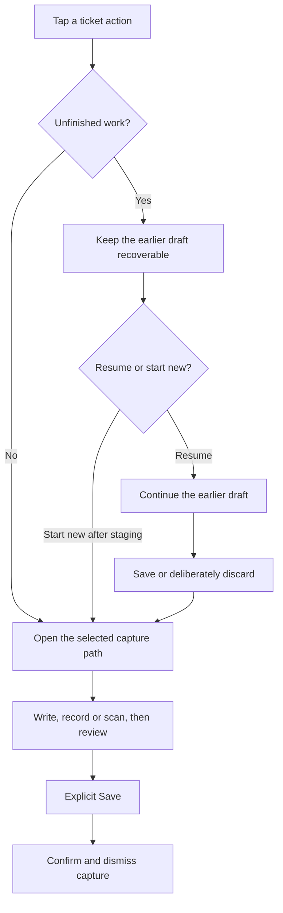

# Capture Ticket widget plan

Status: behavior planning only. The user confirmed that the visual concept already exists and asked to plan what the ticket does before implementation. No Android code or Figma artwork is changed in this pass.

[Existing editable Capture Ticket in Figma](https://www.figma.com/design/dJOugcd2V82nQUA1MjyINI?node-id=77-994)

The live Figma master was inspected: **316 × 188**, a 4 × 2 target, with “Keep a passing thought.”, **Write a note**, a microphone action and a scan action. It uses Roboto and Source Serif 4. These are the three entry points this plan follows; a separate Paste button is not part of this concept.

## Purpose

Capture a passing thought from the home screen without finding the right page in Cobalt. The ticket is a shortcut into capture: writing, recording and reviewing happen inside the app.

## Proposed first version

| Ticket action | What opens | What the user keeps |
| --- | --- | --- |
| Write a note | The existing text editor, focused with the keyboard ready. The title is optional. | A note after pressing Save. Existing clipboard paste stays available inside this editor. |
| Microphone | The existing voice recorder. Recording starts when the user presses Record; microphone permission is requested there if needed. | A playable voice memo after Stop, review and Save. Transcription is optional and must not block keeping the recording. |
| Scan | A small source chooser with **Image or screenshot** and **Current screen**, followed by region or full-image OCR and editable review. | The reviewed text as a note; keeping the source image or selected extracted links is an explicit choice, never an automatic extra capture. |

**Confirmed Scan choice:** the user selected a choice between both sources. Camera capture is outside this first pass unless requested.

Scan routes:

- **Image or screenshot:** open the system photo picker, select an image, select a region or use the full image, extract text, then review and Save. Canceling the picker returns without saving an empty item.
- **Current screen:** request Android's capture consent, then provide a small floating **Capture / Cancel** control. The user can reach the desired screen before pressing Capture. Hide the chooser/control before taking the screenshot, then select a region or use the full screen and review the result. A home-screen widget begins on the launcher; it cannot assume the last app is still visible. This control is a proposed addition to the screen-OCR route, so it can capture useful content beyond the launcher; it uses the app's floating-tool permission flow where required.

Only the current-screen route requests screen-capture consent. Permissions or cancellation leave earlier drafts and captures untouched.

Paste is an explicit editor action. The launcher widget does not read or display clipboard contents. A pasted standalone URL can be reviewed as a link; mixed text containing a URL must keep the complete text rather than silently discarding everything except the URL.

## Tap, review and save

1. Tap one of the three ticket actions.
2. Cobalt opens the chosen capture path directly, with the ticket's destination already selected. Scan has its intentional two-source chooser; avoid a generic capture-type menu or loading page.
3. Write, record or select an image. Review and edit the result.
4. Save creates one capture through Cobalt's existing save path, then confirms success and dismisses capture. Navigation returns to the launch context without closing unrelated work in the app.

Typing does not depend on a network request. The recorder and image-selection interface also appear before optional processing. OCR and transcription may take time; show their status within the already visible capture interface, preserve the source, and offer retry. No blank screen or navigation spinner should hide the interface.

Voice must remain useful offline or without an AI key: keep the recording, and let transcription run separately if available. No recording starts from a widget redraw or in the background. For the first version, leaving an active recording stops and stages the completed clip for review; background recording is a separate feature.

An untouched capture or canceled image picker creates no empty saved item. Back after entering content keeps a recoverable draft; discarding content requires an explicit choice. A failed save retains the draft and offers retry. Repeated taps or repeated Save must not create duplicates.

## Destination and setup

Reuse the Folio/Screening settings structure: live ticket preview, the small Customize heading with its information tooltip, and **one optional custom-folder selector**. Keep the existing ticket's visual style, app theme and typography behavior. No new appearance settings are needed for this version.

Without a chosen folder, captures use their normal system category. With a folder, they also belong to that custom folder; voice remains an audio capture and a text note remains a note. The destination remains editable before Save.

Each placed ticket has an independent destination. A renamed destination should stay connected where the app can track it. A deleted destination falls back to the normal category with an inline explanation and a chance to choose another folder; it must not recreate the deleted folder.

Placement follows the current widget lifecycle: drafts are labelled **Preview · not added** and stay out of installed-widget lists. Normal deletion removes its saved entry. **Remove from Cobalt** handles a launcher-retained registration. Removing or reconfiguring the ticket only changes widget settings; it never removes captures or folders. Preserve restoration data for Android's ID remapping.

## Unfinished work and recovery

A ticket tap must not replace an unfinished capture or an unsaved edit to an existing item. Resume that work first and retain the requested ticket action. Offer an explicit route to a new capture only after the earlier draft is safely kept. After the user saves or deliberately discards the earlier work, the pending action can continue once.

Entry decisions:

| Existing state | Ticket behavior |
| --- | --- |
| No draft, an untouched empty capture, or a saved item with no unsaved edits | Open the requested capture immediately. Merely viewing a saved note must not trigger a draft warning. |
| A capture or edit with unsaved content | Keep that work recoverable. Offer **Resume draft** or **Start new capture**; Start new becomes possible after the earlier draft is safely staged, rather than discarding it. |
| An active voice recording | Keep the recorder visible, retain the ticket request, and let the user stop the recording before switching. Never start a second recorder. |
| Recovery/migration is active | Keep the request and show the existing recovery interface. Continue the requested action once recovery completes. |

Maintain one active capture and at most one pending ticket request. Rapid repeated taps update that pending choice instead of producing a backlog of captures. Once the new capture is visible, mark the request consumed and remember its capture ID, so recreation resumes that same capture rather than starting another one.

The pending action, originating ticket and destination must survive activity/process recreation. Written drafts, selected-image sources and completed recordings need durable draft references; an in-memory bitmap or map is insufficient. An interrupted, unfinalized recording cannot be promised recoverable and should produce a clear recovery result rather than an empty memo.

If startup recovery or note migration is active, retain the ticket request and resume it after the gate clears. Permissions, canceled pickers and processing errors must leave existing work intact.

Screen-capture permission tokens are not durable draft state. After process loss, restore the pending scan/source and request fresh Android consent if needed; do not try to reuse an expired projection token.

## Existing foundations and work required before wiring the widget

Existing foundations:

- [MainActivity quick actions](../app/src/main/kotlin/com/example/MainActivity.kt) already route text, audio and OCR actions.
- [CobaltViewModel.startManualCapture](../app/src/main/kotlin/com/example/ui/viewmodel/CobaltViewModel.kt) accepts initial custom folders.
- [CaptureScreen](../app/src/main/kotlin/com/example/ui/screens/CaptureScreen.kt) has clipboard UI, the photo picker, voice capture and review.
- [AudioRecorderComponent](../app/src/main/kotlin/com/example/ui/components/AudioRecorderComponent.kt) provides recording and permission UI.
- CobaltViewModel exposes image/region OCR and audio transcription. [OcrCaptureActivity](../app/src/main/kotlin/com/example/OcrCaptureActivity.kt) captures the current screen, a distinct source from the image picker.

Source inspection identified boundaries that must be fixed or validated during implementation:

- `startManualCapture` clears `captureDrafts` and replaces the active capture. A protected ticket entry controller must run before it; direct shortcut wiring would risk unfinished work.
- The recorder's disposal path stops/releases recording without passing that clip to the normal completion callback. Interruption handling must stage the completed recording rather than losing its reference.
- Recording completion currently calls transcription automatically. Separate local clip preparation and Save availability from optional transcription; audio reads and preparation must run off the UI thread.
- Ordinary capture state includes an in-memory per-type draft map. Verify durable restoration for small text captures, image sources and recorded audio; do not assume the existing file-editor journal covers every capture type.
- Carry the destination through OCR, type changes, saving and recovery. Revalidate it before saving, without making the capture interface wait for a fresh database query.
- Current `OcrCaptureActivity` starts capture shortly after consent. Ticket screen mode needs an explicit target-ready Capture step, with cancel/timeout handling, instead of capturing while the source chooser or launcher is still the unintended target.

Use explicit Activity PendingIntents with independent action identities for each ticket and action. Reuse per-widget staged pin/configuration, shared inventory and restoration patterns. Ticket rendering needs configuration, app appearance and icons only; it must not load note bodies, run recommendation queries or add periodic background refresh just to display a static ticket.

## Implementation order after the behavior is agreed

1. Protect and restore capture drafts, pending actions and completed recordings.
2. Connect each ticket action to the existing capture/review flow and independent destination.
3. Add the provider, settings/pinning and shared-inventory integration using the existing Figma ticket.
4. Verify local flows and then launcher behavior on an emulator. The attached personal phone remains outside the test environment.

## Acceptance checks

- One tap opens the note editor, recorder or Scan source chooser on warm and cold launch; the selected Scan source then follows its specific route.
- Notes, standalone URLs and multiline pasted text keep the intended content and require explicit Save.
- Microphone permission rejection, short recordings, interruption, offline use and failed transcription preserve completed clips and earlier work.
- Image selection cancellation, empty clipboard and OCR errors leave existing content intact.
- An unfinished capture survives another ticket action, backgrounding and process recreation.
- The configured folder survives process death, stays editable in review, and missing folders fall back without being recreated.
- Native placement, cancellation, resizing, reconfiguration and multiple tickets work independently.
- The three actions remain clear and usable with at least 48 dp targets, large text, narrow hosts and both theme modes. Icon actions have meaningful accessibility names.
- Pocket Folio and Screening Card continue to work after the new provider is added.
