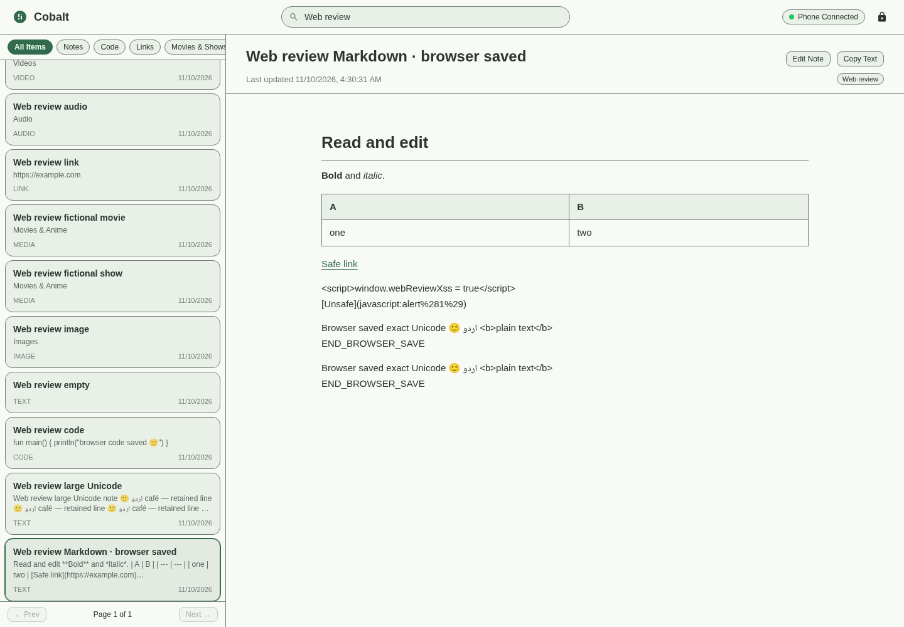
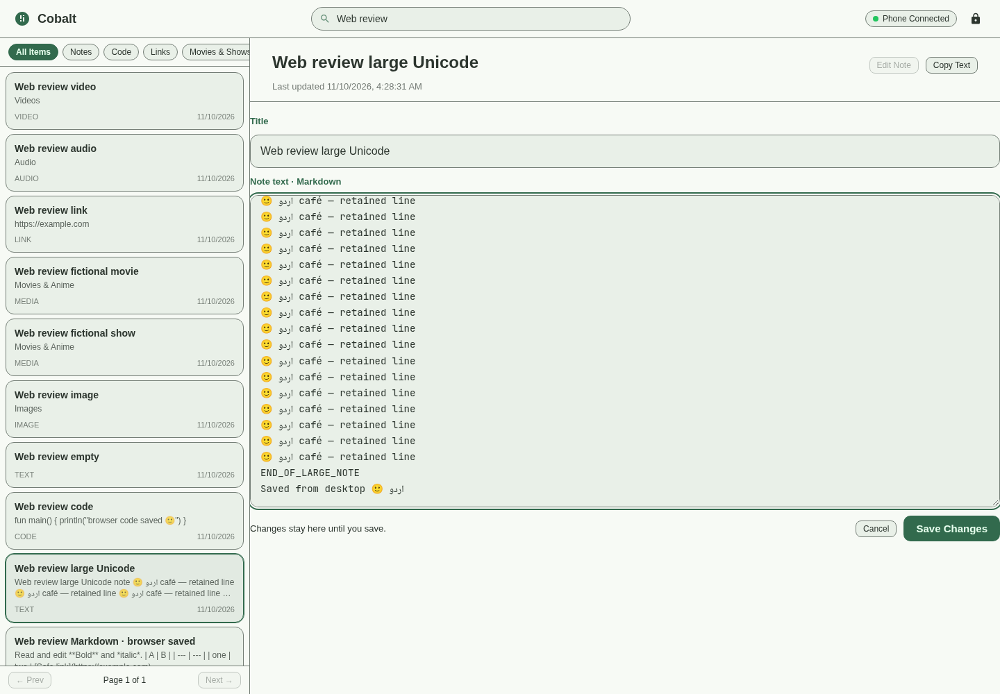
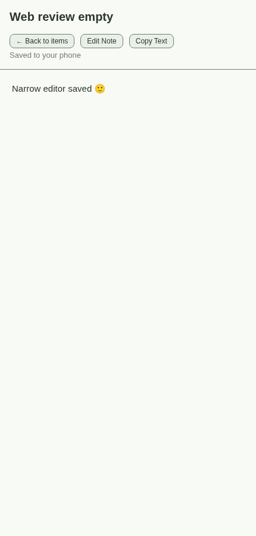

# Web companion runtime review — 2026-11-10

Historical report for the unpublished 2.2.3/19 builds. See [2.3.0 release preparation](release-preparation-2.3.0.md) for the current version, development feature flag and verification limits.

The latest debug APK was built with Gradle, installed in place on **emulator-5554 (Pixel 10 Pro XL, Android 17/API 37)**, and tested through its actual HTTP server. Its version is still **2.2.3 / code 19**, package `com.hanan_bhatti.cobalt.debug`. The installed APK's SHA-256 matches the local Gradle output.

**Result:** reading, editing and saving text/code notes now work. The original implementation had no edit/save endpoint or editor UI. Full bodies above the native small-note threshold were also not loaded correctly. The full source/commit audit and corrections are in [the implementation ledger](web-companion-implementation-ledger.md).

## Data and artifact evidence

- All **500 original debug records**, including their inline body text and every metadata column, matched the private pre-update row fingerprint exactly after testing. No original record was deleted or reset.
- **15 explicitly labelled synthetic fixtures** were added, bringing the debug app to **515 records**: 506 TEXT, 2 CODE, 2 IMAGE, 1 LINK, 2 MEDIA, 1 AUDIO and 1 VIDEO. Movie/show records are fictional test records.
- Web-saved text and its current generation survived an intentional Android process stop and app/server restart. Old sessions became invalid after restart and PIN rotation.
- Production Cobalt was not uninstalled or cleared. Debug installation was an in-place update. No version, tag, or release was created.
- Installed debug APK SHA-256: `752753d4455e73adba2302c4b006d557c44c7d0aa0f713a4c9ce9e4918c3118c`.
- [Machine-readable results](verification/web-companion-2026-11-10/results.json) include the counts, test coverage, timing samples and artifact check. PINs, tokens, signing credentials and database backups remain outside the repository.

## Verification matrix

| Behavior | Evidence and result |
| --- | --- |
| Baseline server connection | Original debug server accepted PIN login and listed 500 records through ADB forwarding. Edit/save was absent in the source. |
| Start, stop and restart | Android settings enable/disable tested; process stop closed the server; restarting created a working new session. |
| PIN and lockout | Actual HTTP: incorrect attempts took approximately 509, 1017, 1517 and 2011 ms; fifth attempt returned 429 with a 600-second lockout. Correct PIN remained blocked until manual rotation. Unit tests cover expiry, tripwire, locale-independent digits and reactive rotation. |
| Session/logout | Login, cookie authentication, logout and clearing visible note content passed in Chromium. Restart/rotation rejected old sessions. Unit tests cover session expiry and ownership. |
| HTTP request protection | Real JVM sockets tested invalid Host/Origin, OPTIONS checks, oversized headers, invalid/duplicate content lengths and unsupported transfer encoding. Flood budget tested with a deterministic clock. |
| List/search/filters | Browser search, TEXT/CODE/link/movie-show/attachment views and next-page navigation passed. Unit tests verify exact folder membership and hidden deleted records; Android tests use the native search path. |
| Markdown reading | Headings, emphasis, tables, safe links, code and literal HTML were checked. Script nodes/unsafe JavaScript links did not appear; no test script executed. |
| Large-note reading | Complete 456 KB Unicode text, including its tail marker, arrived over HTTP and opened in the browser reader/editor. It was not substituted with a preview. |
| Edit/save/reopen | Title/body edits, Unicode, code saves, browser reload and native repository reopen passed with exact expected content. Five additional large-note writes each reopened exactly. |
| Cancel and draft protection | Declined discard confirmation retained the draft; confirmed cancellation discarded only unsaved changes. Client regressions cover failed-save draft retention, pending-lock navigation and title-only CRLF preservation. |
| Phone editor conflict | A fixture was opened and edited through the actual Android UI. Web lock acquisition/write returned 409; Android Back released the lock. |
| Other browser/stale revision | Android HTTP and unit tests rejected another session's lock/write, a stale revision, expired heartbeat and phone preemption during save. |
| Native history | Android HTTP test read the previous complete generation after saving the replacement. Native commit regression rejects a revoked guard after staging without replacing the original head/body. |
| Empty note | Empty note opened correctly; empty-body saving is covered by the router test. A narrow-screen edit subsequently saved text into an empty fixture. |
| Images/audio/video | Image loaded with nonzero natural dimensions. WAV and MP4 fixtures loaded, played with advancing playback time, and paused in Chromium. Android tests verified attachment response bytes. |
| Links/movies/shows | Local saved fixtures opened read-only, with edit-lock requests rejected. This does not validate live TMDB/Trakt discovery or every provider detail field. |
| Responsive UI | At 430 × 900: note opened, edited, saved, returned to the item list, and had no horizontal document overflow. Desktop was tested at 1440 × 1000. |
| Clipboard | Browser Copy Text completed successfully. Insecure-LAN fallback exists in the client; its real physical-phone behavior was not separately tested. |
| Crashes | No JavaScript page errors in the complete browser run. No debug Java crash marker or crash/ANR exit reason in the recorded review interval; exits were intentional force-stops and package updates. |

## Focused automated checks

**48 distinct JVM tests passed across runs:** security 11, session registry 7, socket/HTTP 10, router 7, note editing 9, native prepared commit 4. The first focused run passed 47/48; its old logout fixture omitted the now-required JSON content type. That request was corrected and all seven router tests passed on rerun. The final Gradle install/router run completed successfully.

**9 client regression tests passed**, plus **2 Android instrumentation methods** and the complete real-server Chromium workflow. Early browser attempts also exposed the too-small request budget; the final workflow passed after correction. Test selectors/pagination expectations were corrected to match the actual fixture data.

The broad 1,000-revision storage stress case was stopped while verifying historical generations; it is **not counted as a passing test**. This report does not claim that the entire repository test suite or every Android/browser combination ran.

Reproduce the focused checks:

```sh
./gradlew :app:testDebugUnitTest --tests 'com.example.web.*' --tests 'com.example.notes.PreparedNoteCommitTest'
node --test scripts/web/client.test.mjs
./gradlew installDebug :app:assembleDebugAndroidTest
adb -s emulator-5554 install -r app/build/outputs/apk/androidTest/debug/app-debug-androidTest.apk
adb -s emulator-5554 shell am instrument -w -r -e class com.example.web.WebCompanionDeviceTest com.hanan_bhatti.cobalt.debug.test/androidx.test.runner.AndroidJUnitRunner
```

The device tests intentionally retain labelled fixtures in the debug sandbox for manual browser review. They do not clear the application database.

## Performance sample

For a **456,083-byte UTF-8 note**, ten authenticated reads measured **93.8 ms median / 106.3 ms maximum**. Five slightly growing edits measured **382.3 ms median / 518.9 ms maximum**, including HTTP, JSON and durable saving; all five reopened exactly. These are emulator/ADB-forwarding samples, not a general device benchmark, battery measurement, or proof of leak-free operation.

## Connection and remaining scope

The server is currently enabled on the debug emulator. Forwarding is configured:

```sh
adb -s emulator-5554 forward tcp:18080 tcp:8080
```

Open **http://127.0.0.1:18080** and enter the PIN shown in **Settings → Web Companion**. The emulator's `10.0.2.x` NAT address is not the laptop browser address. A real phone uses its displayed local-network address; physical LAN/hotspot routing was not tested here.

Web note bodies are bounded to **5 MB**, attachments to **10 MiB**. Larger items remain intact for the native app. The server uses **HTTP**, is tied to the app process, and has **no foreground service**. Background/screen-off survival is not guaranteed. Search uses the native bounded index rather than promising exhaustive searching inside huge notes. Creation/deletion, backups, encryption, biometric locking, web movie-metadata editing and sync are outside this implementation.

`cleanup/cobalt-single-app` was already contained in local `main`. The merge confirmed it was up to date, and **main was pushed as `b898d30`** with a `[skip ci]` marker to avoid automatically publishing v2.2.3. Web corrections remain on `feature/local-web-companion`; they were not merged into main.

## Captures from the tested client






